# Etqan EduPlatform (منصة إتقان التعليمية)
> **Custom Teacher Workbook & Educational Material Customization Platform, 5-Step Order Pipeline & Admin Operations**

[](https://react.dev)
[](https://www.typescriptlang.org)
[](https://vitejs.dev)
[](https://tailwindcss.com)
[](https://ui.shadcn.com)
[](src/__tests__/)
[](LICENSE)

---

## 📌 Executive Summary

**Etqan EduPlatform (منصة إتقان التعليمية)** is an Arabic-first (RTL) full-stack e-commerce and interactive customization platform designed specifically for educators, schools, and academic institutions across the Middle East. It streamlines the ordering, personalization, and fulfillment of curriculum workbooks, teacher lesson planners, and professional portfolio binders.

The platform unifies:
1. **Interactive 5-Step Customization Pipeline:** Real-time cover personalization (educator credentials, academic qualifications, school crest upload with instant preview).
2. **Protected Educational PDF Viewer:** Canvas-based interactive previewer with anti-copy, hotkey suppression, and right-click protection for printable courseware.
3. **Comprehensive Admin Control Suite:** Order lifecycle management, catalog CRUD, customer management, and sales analytics powered by **Recharts**.
4. **Dual-Mode Zero-Cloud Architecture:** Built-in offline mock adapter with synthetic seed data, eliminating external database dependencies for evaluation while offering seamless live Supabase connectivity.

---

## 🎯 The Engineering Problem & Solution

| Operational Challenge | Engineering Solution in Etqan EduPlatform |
|---|---|
| **Manual School Cover Customization Bottlenecks** | Structured 5-step wizard with client-side form validation (**React Hook Form + Zod**) and live image preview that binds teacher data to order line items. |
| **Piracy of Printable Academic Courseware** | Custom-engineered `PDFViewer` with keyboard event blockers (`Ctrl+S`, `Ctrl+P`), disabled context menus, and suppressed browser download bars. |
| **Fragmented Order Fulfillment Tracking** | Admin dispatching workflow managing order states (`pending` ➔ `processing` ➔ `ready` ➔ `delivered`) with audit notes and customer WhatsApp integration. |
| **Heavy Cloud Dependency During Evaluation** | Intelligent dual-mode client: automatically runs in **Zero-Cloud Demo Mode** with persistent LocalStorage state when live Supabase credentials are not present. |

---

## 📸 Verified UI Walkthrough

### Storefront & Teacher Customization Experience

| Homepage & Category Discovery | Products Catalog |
|:---:|:---:|
|  | 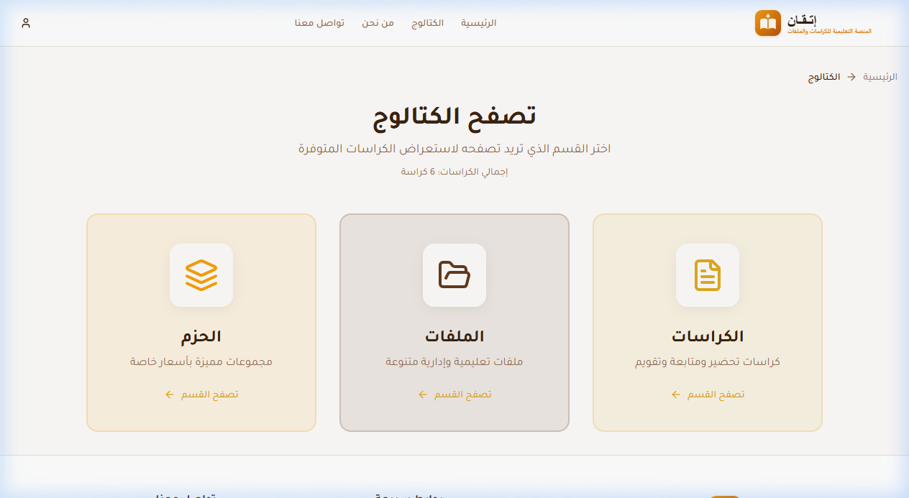 |
| *Hero banner with neutral Etqan vector branding and category navigation.* | *Educational workbooks with pricing, specs, and category filters.* |

| 5-Step Customization Wizard | Product Details & Protected PDF Preview |
|:---:|:---:|
| 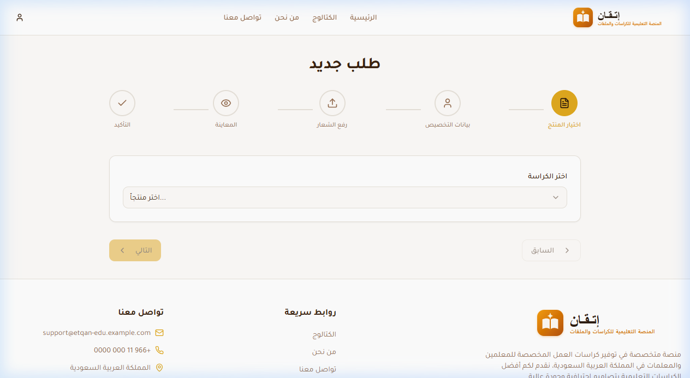 | 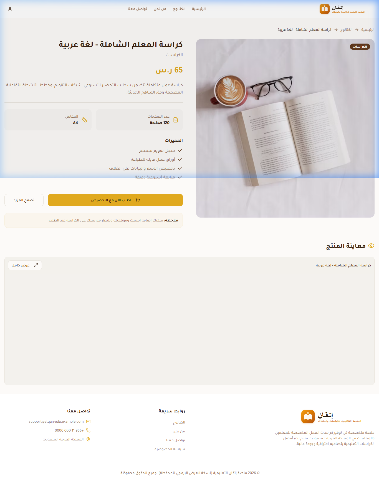 |
| *Interactive customization: teacher name, school, and live logo upload.* | *Full workbook specs, feature highlights, and protected PDF preview.* |

| 1-Click Demo Authentication |
|:---:|
| 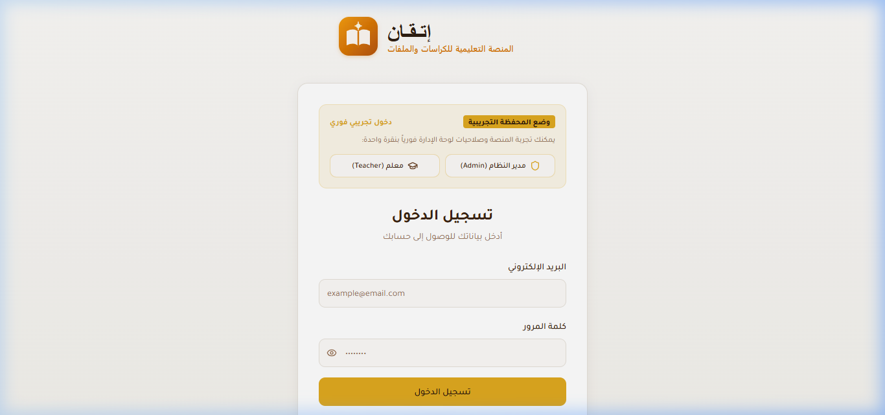 |
| *Fast evaluator access: one-click login buttons for Admin and Teacher.* |

---

### Admin Operations & Control Suite

| Executive Analytics Dashboard | Product & Catalog Management |
|:---:|:---:|
| 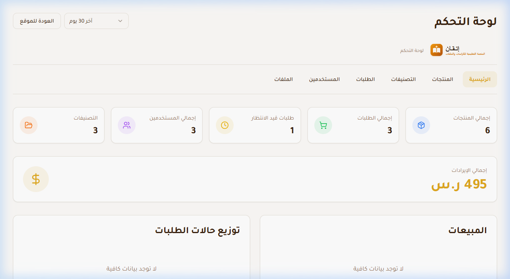 | 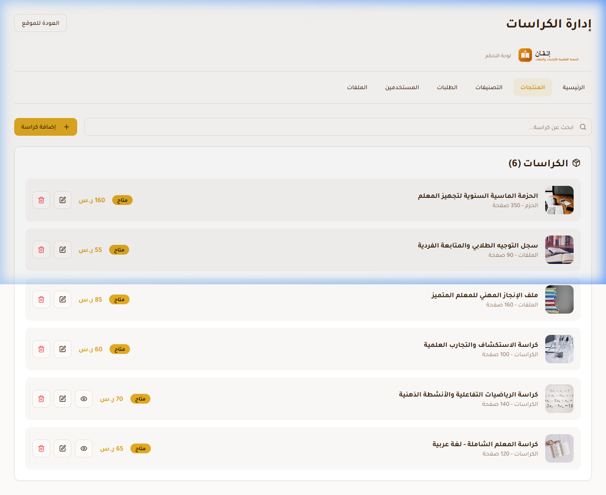 |
| *Real-time metrics, revenue calculations, and Recharts visual graphs.* | *Complete product catalog table with editing, pricing, and availability.* |

| Order Fulfillment & Status Dispatch | Category Hierarchy & Product Counts |
|:---:|:---:|
| 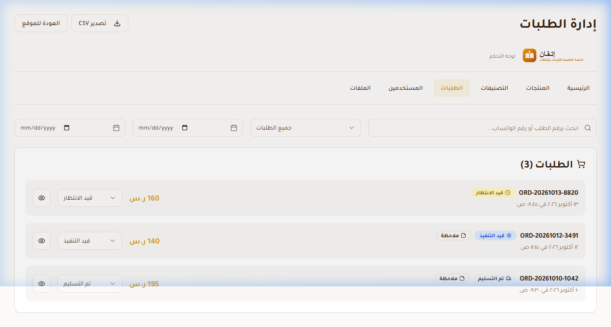 | 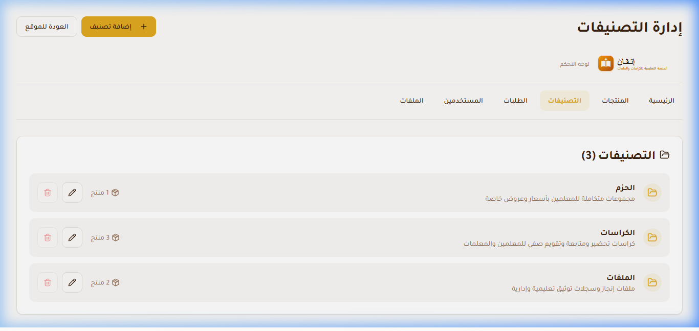 |
| *Status filtering (`pending`, `processing`, `delivered`) and notes.* | *Catalog structure management with automated product count rollups.* |

| User Directory & Role Assignment | Cloud Storage Bucket Explorer |
|:---:|:---:|
| 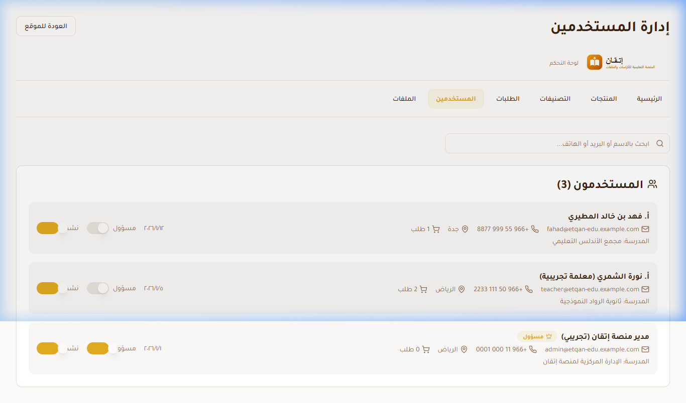 | 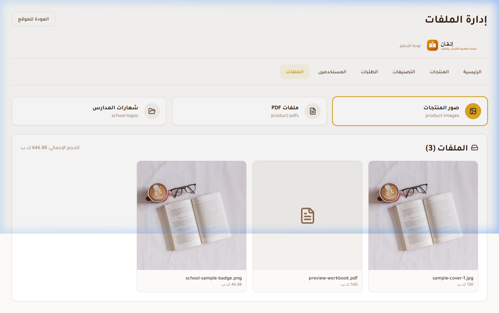 |
| *Customer profiles, qualification tracking, and admin role elevation.* | *Storage buckets browser for product covers, PDFs, and uploaded logos.* |

---

## 🏗️ Architectural Topology

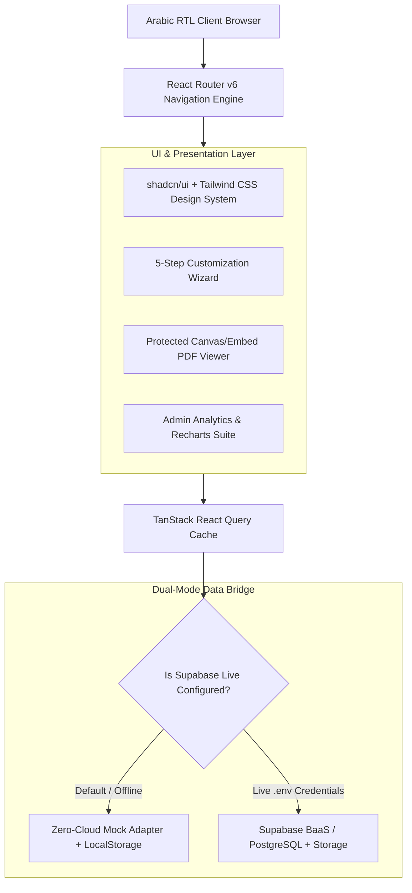

### Key Design Decisions
- **RTL-First Typography:** Arabic font loading (`Tajawal`) paired with Tailwind directional layout utilities (`dir="rtl"`).
- **Zero-Cloud Self-Contained Demo:** Evaluators can inspect the full application immediately without signing up for cloud accounts or configuring Docker.
- **Vector Branding Asset:** Custom SVG vector identity (`logo.svg`), reducing asset footprint from 401KB to 1.9KB with infinite resolution scaling.

---

## 🚀 Quickstart & Local Setup

### Prerequisites
- **Node.js 18+** (Tested on Node v22.18)
- **npm 9+**

### 1. Clone & Install Dependencies
```bash
git clone https://github.com/hussainalkhamri/etqan-eduplatform.git
cd etqan-eduplatform

# Install Node dependencies
npm install
```

### 2. Configure Environment (Optional)
By default, the application runs in **Zero-Cloud Demo Mode** with complete offline mock data. To connect to your own Supabase instance:
```bash
cp .env.example .env
# Edit .env with your VITE_SUPABASE_URL and VITE_SUPABASE_PUBLISHABLE_KEY
```

### 3. Launch Local Dev Server
```bash
npm run dev
```
Open **[http://localhost:8080](http://localhost:8080)** in your browser.

---

## 🔑 Demo Access Credentials

The platform features instant one-click login on `/auth` for evaluator convenience:

| Role | Email | Password | Access Scope |
|---|---|---|---|
| **Store Administrator** | `admin@etqan-edu.example.com` | `demo123456` | Full `/admin` analytics, product CRUD, order dispatching |
| **Elementary Teacher** | `teacher@etqan-edu.example.com` | `demo123456` | Catalog browsing, custom ordering, account order history |

*Tip: The login page includes quick **"مدير النظام (Admin)"** and **"معلم (Teacher)"** buttons to bypass typing.*

---

## 🧪 Testing & Quality Assurance

The application includes an automated test suite powered by **Vitest 2.1**:

```bash
# Execute test suite
npm test

# Run ESLint compliance check
npm run lint

# Build production bundle
npm run build
```

**Test Results:**
```text
 ✓ src/__tests__/platform.test.ts (8 tests) 25ms

 Test Files  1 passed (1)
      Tests  8 passed (8)
   Duration  1.44s
```

---

## 🔒 Security & Privacy Policy

This repository is an engineered, sanitized demonstration of custom e-commerce and courseware software:
- **Zero Real Client Records:** All teacher profiles, school crests, orders, and phone numbers are 100% synthetic mocks.
- **Zero Exposed Secrets:** Active `.env` files are strictly omitted and ignored; sample templates are provided in `.env.example`.
- **Company Neutrality:** Original private client branding has been completely excised and replaced by the neutral **Etqan EduPlatform (منصة إتقان التعليمية)** identity.

---

## 📚 Deep Technical Documentation

- [Architecture & Design Decisions](docs/architecture.md)
- [Realistic User Journey & Scenarios](docs/user-journey.md)
- [Data Model & Database Schema](docs/data-model.md)
- [Security, Privacy & Compliance](docs/security-and-privacy.md)
- [Test Strategy & Verification](docs/testing.md)

---

## 👤 Author & Contact

**Hussain Alkhamri**  
- **Email:** [saleh7ussain@gmail.com](mailto:saleh7ussain@gmail.com)  
- **GitHub:** [hussainalkhamri](https://github.com/hussainalkhamri)  

*License: [MIT](LICENSE)*
