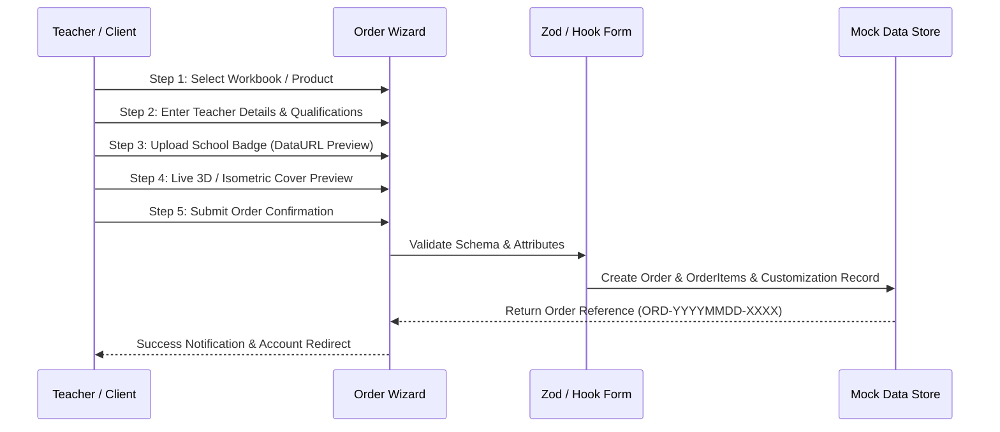

# Architecture & Design Decisions: Etqan EduPlatform

## 1. System Overview

**Etqan EduPlatform** is built as an Arabic-first, highly responsive web application designed for interactive educational customization and teacher workbook fulfillment.

The platform architecture follows clean separation of concerns:
1. **Presentation Layer:** React 18 with TypeScript and Tailwind CSS, leveraging accessible headless UI primitives from Radix UI via shadcn/ui.
2. **State & Query Layer:** TanStack React Query v5 provides client caching, optimistic updates, and declarative server state synchronization.
3. **Data Layer (Dual-Mode):**
   - **Zero-Cloud Mock Adapter (Default):** Local, in-memory/localStorage adapter loaded with rich synthetic seed data. Guarantees 100% offline functionality for evaluation.
   - **Live Supabase Client:** Connects to PostgreSQL, Auth, and Storage when valid environment variables are supplied.

```mermaid
graph TD
    Browser[Client Browser (Arabic RTL)] --> Router[React Router v6]
    Router --> Pages[Application Pages & Admin Panel]
    Pages --> Hooks[Custom Hooks & useAuth]
    Hooks --> QueryClient[TanStack React Query Cache]
    QueryClient --> DataBridge{Supabase Adapter Bridge}
    
    DataBridge -->|Offline / Demo Mode| MockEngine[Local Mock Storage Engine]
    DataBridge -->|Production / Live Mode| SupabaseCloud[Supabase Cloud BaaS]
    
    MockEngine --> LocalStorage[(Browser LocalStorage)]
    SupabaseCloud --> Postgres[(PostgreSQL Database + RLS)]
```

## 2. Protected PDF Viewer Architecture

To safeguard proprietary workbooks and printable educational materials, `PDFViewer.tsx` implements multi-layer client-side copy protection:
- Intercepts and blocks global print and save hotkeys (`Ctrl+S`, `Ctrl+P`, `Ctrl+Shift+S`).
- Disables mouse right-click context menus (`contextmenu` event suppression).
- Enforces user-select restrictions via CSS (`user-select: none`).
- Loads PDF streams inside an isolated container with embedded viewer controls configured to suppress default toolbars (`#toolbar=0&download=0&print=0`).

## 3. Five-Step Customization Pipeline


